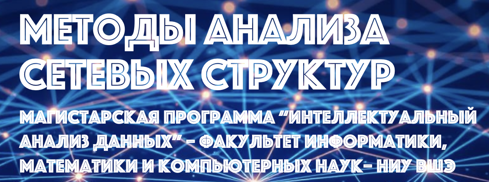

# Методы анализа сетевых структур

Материалы курса магистратуры «Интеллектуальный анализ данных», НИУ ВШЭ – Нижний Новгород.

| Год | Материалы |
|---|---|
| **2027** (в разработке) | [2027/README.md](2027/README.md) |
| 2026 | [2026/README.md](2026/README.md) |
